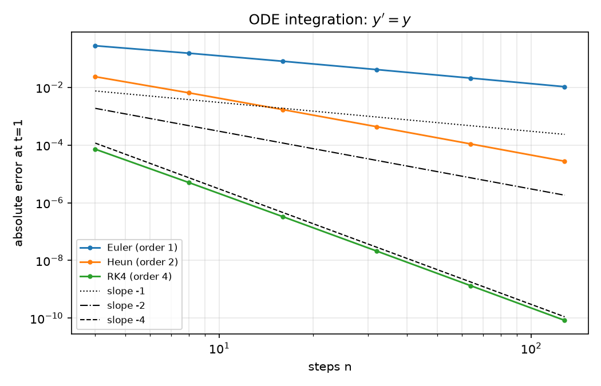
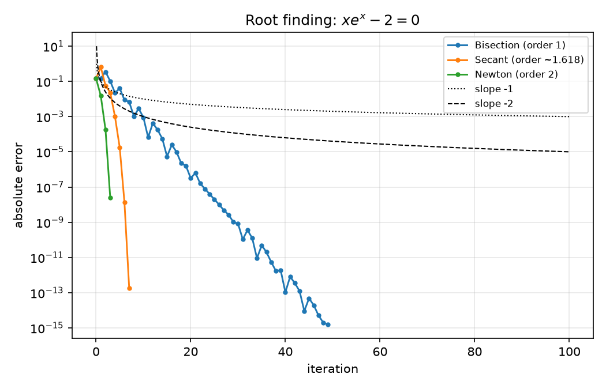

# numerical-methods-python

Numerical solvers implemented from first principles in NumPy, each instrumented
so its **order of convergence can be measured rather than assumed**.

Every solver returns a `Result` carrying the full iteration history, which is
what makes the convergence analysis in the test suite possible.

```
Bisection (order 1)          50 iters   |error| 1.554e-15
Secant (order ~1.618)         8 iters   |error| 1.822e-13
Newton  (order 2)             5 iters   |error| 2.436e-08
```

## Why the instrumentation matters

The interesting part is not that Newton converges — it is *measuring* how fast,
and knowing when a measurement is meaningless. Two cases from this repo:

**Bisection's error is not monotone.** Because the root does not sit at the
bracket midpoint, successive midpoints alternate above and below it, so the
error oscillates *inside* a halving envelope:

```
1.47e-01  1.47e-01  3.53e-01  1.03e-01  2.24e-02  4.01e-02  8.86e-03 ...
```

A pointwise order estimate on that sequence is meaningless. The well-defined
quantity is the envelope rate, and the test asserts the rate instead: twenty
extra bisections must shrink the error by about `2**20`.

**The secant recurrence is two-step.** It satisfies `e_n ~ C e_n e_{n-1}`, which
is *not* of the form `e_{n+1} = C e_n^p` that the standard log-ratio estimator
assumes. Its order is the golden ratio, but you cannot recover that number with
the textbook formula — you have to show `e_n / e_{n-1} -> 0` directly.

**Newton's last iterate sits on the noise floor.** Double precision cannot
resolve below `eps * |x| ~ 1.9e-16` here, so the final iterate lands *on* that
floor rather than on the asymptotic trend. Averaging it in drags the measured
order from 2.0 down to 1.5, which is why `empirical_order` takes an `atol` and
the test passes the attainable accuracy explicitly.

Only Newton's column in the comparison output is a valid order estimate, and
the script says so rather than quietly printing numbers that look meaningful.

## What is implemented

| Module | Contents |
|---|---|
| `rootfinding.py` | `bisection` (order 1), `secant` (order ~1.618), `newton_raphson` (order 2) |
| `ode.py` | `euler` (1), `heun` (2), `rk4` (4) |
| `optimization.py` | `gradient_descent` (geometric decay), `stochastic_gradient_descent`, `adam` (with bias correction) |
| `linalg.py` | `power_iteration` (dominant eigenpair), `conjugate_gradient` (SPD systems) |
| `convergence.py` | `empirical_order`, `richardson_extrapolation` |

Reference problem throughout: `f(x) = x e^x - 2`, whose root is `W(2)`, the
Lambert W function, computed to 40 digits in the test suite.

## Measured vs theoretical, ODE integrators

`y' = y`, `y(0) = 1`, exact `y(1) = e`. Doubling the step count should divide
the error by `2**p`:

| Method | theory p | n=20 error | n=40 error | ratio | implied p |
|---|---|---|---|---|---|
| Euler | 1 | 6.498e-02 | 3.322e-02 | 1.96 | **0.97** |
| Heun | 2 | 1.091e-03 | 2.779e-04 | 3.93 | **1.97** |
| RK4 | 4 | 1.358e-07 | 8.666e-09 | 15.67 | **3.97** |




## Usage

```python
from numethods import newton_raphson, empirical_order
import math

f  = lambda x: x * math.exp(x) - 2
df = lambda x: math.exp(x) * (x + 1)
W2 = 0.85260550201372549134        # the Lambert W value

r = newton_raphson(f, df, x0=1.0)
print(r.x, r.iterations, r.converged)
print(empirical_order(r.errors(W2), atol=1e-15))   # -> 1.98
```

## Running the tests

No pytest required — the suite runs on a bare NumPy install:

```bash
python3 tests/run_tests.py -v
```

```
24/24 passed in 34ms
```

Under pytest the same functions are collected normally.

The tests assert *quantities the theory predicts* — a measured order, a factor
of 16 between two step sizes, a closed-form solution, the CG iteration bound —
rather than just checking that the code executes. Regression paths are covered
too: a bracket with no sign change, `f'(x) = 0`, and a non-positive-definite
matrix all raise instead of returning a wrong answer.

## Notes

- `scipy` is deliberately not a dependency. These are the implementations, not
  wrappers, so the iteration structure stays visible.
- `conjugate_gradient` raises on `p^T A p <= 0` rather than returning a wrong
  answer, since that breakdown means the matrix is not positive definite.
